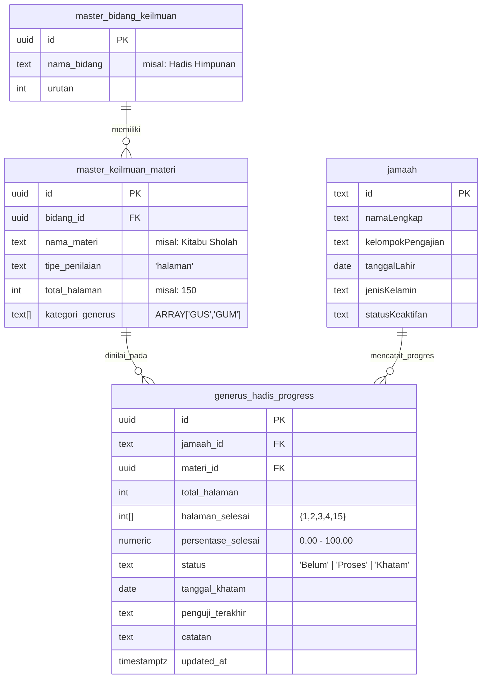

# Product Requirements Document (PRD) & Skema Teknis
## Fitur: Monitoring Hadis Himpunan (Modul PPG - AJI v3.2)

---

### 1. Ringkasan Eksekutif (*Executive Summary*)
Modul PPG (Penggerak Pembina Generus) pada aplikasi AJI saat ini telah memiliki fitur pemantauan presensi generus, pencatatan capaian keilmuan berkala (batch/individu), dan pelacak halaman per halaman (*page-by-page tracker*) untuk materi berbasis kitab seperti Hadis Himpunan.

Dokumen ini mendefinisikan penambahan subtab khusus: **"Monitoring Hadis Himpunan"** pada Modul PPG. Fitur ini dirancang khusus untuk memfasilitasi pendidik, muballigh/muballighot, dan pengurus PPG dalam mengevaluasi progres pengkhataman kitab-kitab hadis himpunan dengan visibilitas ganda:
1. **Daftar Generus yang Sudah Khotam 100%**: Mengidentifikasi generus yang telah menuntaskan seluruh halaman materi hadis tertentu beserta riwayat pengujian dan tanggal khatam.
2. **Matriks Halaman Kosong & Daftar Generus Tertinggal**: Mengidentifikasi secara spesifik nomor-nomor halaman yang masih kosong/belum diisi beserta daftar generus yang belum menyelesaikan halaman tersebut, sehingga pendidik dapat menjadwalkan pembinaan/sambung materi secara presisi.

---

### 2. User Persona & Kebutuhan Pengguna
| Persona | Peran | Kebutuhan Utama |
|---|---|---|
| **Pendidik PPG / Guru Mengaji** | Pengajar di tingkat kelompok/desa | Mengetahui halaman mana yang belum dimaknai oleh generus di kelasnya untuk menentukan jadwal materi berikutnya. |
| **Pengurus PPG Kelompok** | Koordinator generus rukun/kelompok | Memantau daftar generus di kelompoknya yang sudah khotam 100% untuk persiapan wisuda/sertifikasi pengkhataman. |
| **Pengurus PPG Desa / Admin** | Evaluator kurikulum se-desa | Melihat peta ketercapaian hadis himpunan lintas kelompok dan mendeteksi halaman-halaman yang sering terlewat. |

---

### 3. Lingkup Fungsional (*Functional Scope*)

#### 3.1. Penempatan Navigasi
- Terletak sebagai subtab ke-3 pada Modul PPG:
  `[Data & Monitoring Generus] | [Input Capaian Keilmuan] | [Monitoring Hadis Himpunan] | [Master Kurikulum & Silabus]`
- Menggunakan ID navigasi `subtab-monitoring-hadis` dengan ikon `fa-book-quran`.

#### 3.2. Filter Global & Metrik Agregat
- **Filter**:
  - Kelompok / Rukun (Otomatis terkunci jika login sebagai Operator Kelompok).
  - Jenjang Peramutan (Semua Jenjang, Caberawit, GUS, GUM).
  - Pencarian Kitab Hadis Himpunan.
- **Kartu Metrik KPI**:
  1. *Total Kitab Hadis Aktif*: Jumlah materi bertipe halaman dalam bidang Hadis Himpunan.
  2. *Total Generus Target*: Jumlah santri terdaftar pada jenjang yang ditargetkan.
  3. *Generus Khatam 100%*: Total santri yang telah menyelesaikan 100% halaman.
  4. *Rata-rata Ketuntasan Halaman*: Persentase halaman yang terisi di seluruh generus.

#### 3.3. Pemilihan Materi Hadis Himpunan
- Kartu / Grid interaktif yang memuat semua materi dalam bidang Hadis Himpunan (misal: *Kitabu Sholah 150 Hal*, *Kitabul Adab 80 Hal*, *Kitabul Imarah*, dll.).
- Tiap kartu materi menampilkan:
  - Judul Kitab Hadis & Jumlah Halaman.
  - Jumlah generus yang sudah tuntas (Khatam 100%).
  - Progress bar rata-rata capaian kelompok.
  - Indikator aktif saat dipilih.

#### 3.4. Output Data Setelah Materi Dipilih
Ketika suatu kitab hadis diklik, sistem secara reaktif merender 2 section utama:

##### Bagian 1: Generus yang Sudah Khotam 100%
- Menampilkan tabel/kartu santri yang memiliki `persentase_selesai = 100` atau `status = 'Khatam'` pada materi tersebut.
- Informasi yang ditampilkan:
  - No, Nama Generus, ID Jamaah, Kelompok, Jenjang (Badge).
  - Tanggal Khatam (format Indonesia, e.g., 24 Okt 2026).
  - Nama Penguji Terakhir & Catatan Evaluasi.
  - Tombol Aksi: Buka Rapor Santri Digital / Buka Modal Hadis Tracker.
- Jika belum ada santri yang khatam:
  - Tampilkan empty-state informatif dengan daftar "Generus Mendekati Khatam" (>75% halaman terisi).

##### Bagian 2: Data Halaman Kosong & Daftar Generus (Belum Isi vs Sudah Isi)
- **Filter Mode Tampilan Halaman**:
  - `Semua Halaman Belum Tuntas`: Menampilkan semua halaman yang masih memiliki defisit generus belum mengisi.
  - `Sudah Isi`: **[Fitur Baru]** Menampilkan halaman-halaman yang sudah diisi beserta daftar chip nama generus yang **telah menyelesaikan** halaman tersebut.
  - `Kosong Total (0%)`: Menampilkan halaman yang belum diisi oleh siapapun (0% terisi).
  - `>50% Generus Belum Isi`: Menampilkan halaman dengan tingkat ketertinggalan mayoritas.
  - `Cari No. Hal`: Input lompat cepat ke nomor halaman spesifik.
- **Grid Matriks Halaman Interaktif**:
  - Kotak halaman 1 s/d `total_halaman`.
  - Kode warna:
    - Hijau: 100% generus target telah menyelesaikan halaman ini.
    - Kuning/Oranye: Sebagian generus telah mengisi, sebagian belum.
    - Abu-abu/Merah pudar: Belum ada generus yang mengisi halaman ini.
  - Klik pada kotak halaman langsung melompat (*smooth scroll*) ke baris tabel halaman tersebut dan memberikan highlight animasi keemasan.
- **Tabel Analisis Detail per Halaman**:
  - Kolom:
    - **Nomor Halaman** (e.g. Hal. 1)
    - **Status Keterisian** (Rasio ketuntasan e.g. 17% Terisi & bar visual progres)
    - **Daftar Generus**:
      - Pada mode biasa: Chip merah generus yang **Belum Mengisi** halaman ini.
      - Pada mode `Sudah Isi`: Chip hijau generus yang **Telah Mengisi** halaman ini.
      - Setiap chip generus dapat diklik untuk membuka modal pelacak halaman (*page tracker*) milik santri bersangkutan.
    - **Jumlah Generus** (Badge jumlah generus belum / sudah isi).

---

### 4. Skema Data & Relasi Database (PostgreSQL / Supabase)

Fitur ini memanfaatkan relasi antara tabel `master_keilmuan_materi`, `generus_hadis_progress`, dan `jamaah`:

---

### 5. Rencana Implementasi
1. **Perbaikan Tampilan Loading / Ruang Kosong**:
   - Memperbaiki penutupan tag HTML `.content-body` pada index.html.
   - Menambahkan reset scroll otomatis (`mainWrapper.scrollTop = 0`) saat pergantian subtab agar tampilan selalu berada di paling atas tanpa jeda ruang kosong.
2. **Penerapan Subtab Monitoring Hadis Himpunan**:
   - Menambahkan tombol subtab ke-3 pada header tabs PPG.
   - Menambahkan markup kontainer `#subtab-monitoring-hadis`.
   - Mengimplementasikan logika pemindaian materi Hadis Himpunan, kalkulasi khatam 100%, dan komputasi halaman kosong beserta nama-nama santri yang belum isi di js/ppg.js.
3. **Sinkronisasi & Verifikasi UI**:
   - Build ulang ke `dist/` dan sinkronisasi ke `public/` serta `mobile-app/`.
   - Pengujian visual Puppeteer untuk memastikan semua komponen tampil elegan dan responsif.
